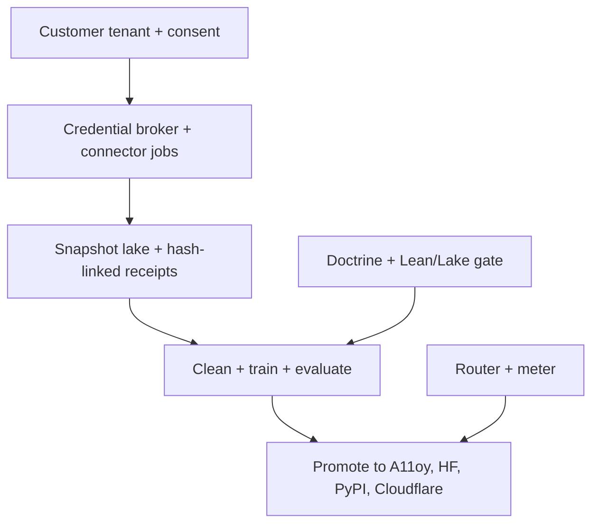

# SZL Holdings estate audit

**As-of:** 2026-11-15 UTC  
**Scope:** Read-only inventory through the connected GitHub installation, followed by a targeted content audit of the platform-critical repositories. No customer credentials or private payloads were collected.

## Inventory result

The current GitHub connector exposed **100 repositories** for `szl-holdings` in this run: **28 archived** and **5 private** according to the returned repository metadata. This is an authenticated inventory snapshot, not a claim that every historical, hidden, or separately installed repository is visible to this connector.

## Platform-critical repository map

| Repository | Observed role | Platform implication |
|---|---|---|
| [`platform`](https://github.com/szl-holdings/platform) | Governed-inference monorepo and control-before-action doctrine | Best home for shared control-plane contracts and tenant policy interfaces. |
| [`a11oy`](https://github.com/szl-holdings/a11oy) | Docker/Hugging Face command-center surface; README links the operational models and datasets | Current Dockerfile is a static SPA front door. It needs a separately authenticated control API; the browser surface must never hold customer secrets. |
| [`a11oy-factory`](https://github.com/szl-holdings/a11oy-factory) | Governed AI distribution surface | Natural promotion and packaging surface after evaluation gates. |
| [`szl-lake`](https://github.com/szl-holdings/szl-lake) | Canonical data-lake/Hugging Face dataset surface | Use as the evidence and feature lineage boundary; add tenant-scoped namespaces and retention metadata. |
| [`lutar-lean`](https://github.com/szl-holdings/lutar-lean) | Lean 4 + Mathlib formal-methods spine; `lakefile.lean` and `lean-toolchain` are present | Use Lake builds as a promotion gate for doctrine and receipt invariants. Record the exact Lean toolchain and commit in each receipt. |
| [`lean-kernel`](https://github.com/szl-holdings/lean-kernel) | Archived proof-kernel repository | Treat as historical reference unless a verified successor is explicitly selected. |
| [`szl-doctrine`](https://github.com/szl-holdings/szl-doctrine) | Published locked governance doctrine and repository-scoped guards | The training doctrine should reference a versioned commit here, never an unpinned branch. |
| [`szl-kernels`](https://github.com/szl-holdings/szl-kernels) | Kernel/provenance contract surface with advisory verdicts | Keep kernel artifacts separate from customer weights and link them by receipt hash. |
| [`szl-serve`](https://github.com/szl-holdings/szl-serve) | Canonical inference recipe, validator, and energy receipt surface | Feed runtime evaluation and metering into the same receipt schema used by Observatory. |
| [`szl-router`](https://github.com/szl-holdings/szl-router) | OpenAI-compatible governed gateway with receipts | A11oy should call this through a tenant-aware policy adapter rather than bypassing receipt validation. |
| [`szl-receipt`](https://github.com/szl-holdings/szl-receipt) | Published signed-receipt Python package (`szl-receipt-dsse`) | Reuse the receipt format; do not invent a second customer-facing provenance format. |
| [`szl-org-health`](https://github.com/szl-holdings/szl-org-health) | Fail-closed GitHub/Hugging Face estate health census | Use its `UNKNOWN` semantics for connector failures; never turn missing data into zero. |
| [`evidence-studio`](https://github.com/szl-holdings/evidence-studio) | Canonical merge sink / one-writer receipt Space | PR #20 adds the Observatory source/release subtree; the existing Space Dockerfile still serves `space/server.py`, so runtime promotion is a separate deployment step. |
| [`governed-inference-meter`](https://github.com/szl-holdings/governed-inference-meter) | Archived/deprecated meter | Route new work to `szl-energy-attest`, as its README states. |
| [`szl-frontier`](https://github.com/szl-holdings/szl-frontier) | Deny-by-default governed memory plane | Candidate policy/memory adapter for tenant-specific training context. |
| [`nexus`](https://github.com/szl-holdings/nexus) | Hugging Face visual/analog-computing Space | Keep as a product Space, not as the control-plane authority. |

## Gaps that block a safe “credentials in, model out” product

1. **Tenant boundary:** no single, versioned tenant/consent contract binds GitHub, Hugging Face, Cloudflare, Lake/Lakefile, and PyPI artifacts to one customer workspace.
2. **Credential broker:** the public A11oy Space is a presentation surface, not a secret manager. Credentials must be short-lived, least-privilege, audited, and never written to GitHub, logs, prompts, or model training data.
3. **Runtime wiring:** Observatory is currently a governed source/release package. The existing Evidence Studio Space runtime is unchanged until a dedicated deployment integration is reviewed and merged.
4. **Evidence-to-training chain:** cleaning, feature extraction, training, evaluation, model-card generation, and publication need one receipt chain with explicit data retention and deletion controls.
5. **Monetization gate:** keep paywalls and revenue claims disabled until x402 wire-format and settlement receipts are verified end to end.
6. **Proof gate:** promotion should record the exact `szl-doctrine` commit, `lutar-lean` Lake build, receipt-library version, source snapshot hashes, and evaluation report.

## Recommended target topology

The product should sell **governed, evidence-backed adaptation**: a customer authorizes specific sources, the system builds an isolated snapshot, produces a clean-data report and evaluation set, trains or adapts a model, and publishes only artifacts whose receipts and gates pass.

That is a strong differentiator. It is not yet safe to call it “one of one” until the tenant boundary, connector broker, repeatable benchmarks, and one production pilot are shipped and independently verified.

## Immediate implementation sequence

1. Land the Observatory package and this audit report behind the open PR.
2. Add a tenant contract and connector capability matrix; start with read-only GitHub/Hugging Face/Cloudflare exports and a local Lake adapter.
3. Add the credential broker and consent ledger using a managed secret store; reject raw tokens in API payloads and logs.
4. Add the Lean/Lake proof gate and receipt-chain fields to the train/evaluate/publish job.
5. Integrate the Observatory API into a dedicated A11oy service or a reviewed Evidence Studio deployment, keeping the current Space entrypoint stable until that integration is tested.
6. Run one synthetic customer pilot, then one real customer pilot with deletion/rollback exercised before enabling monetization.
