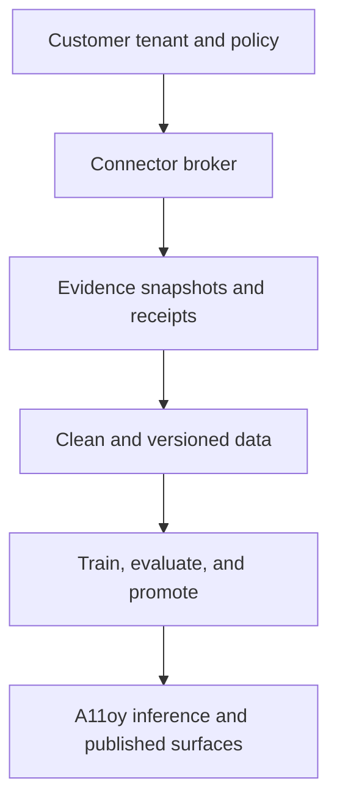

# A11oy Observatory Platform Specification

**Status:** proposed architecture for the SZL Holdings platform

**Owner:** CTO / platform engineering

**Scope:** tenant-isolated analytics, provenance, training, evaluation, and publication across GitHub, Hugging Face, Cloudflare, Lean/Lake, kernels, models, datasets, Spaces, and PyPI.

## Recommendation

Make **A11oy** the inference and orchestration plane, and put a separate **A11oy Observatory control plane** around it. The control plane is the system that connects customer-approved sources, creates immutable evidence snapshots, cleans and evaluates data, launches training jobs, and promotes artifacts to governed destinations. A11oy then answers questions over the resulting tenant-scoped evidence and routes inference to the approved model or Space.

This gives SZL one product loop:

1. A customer creates a tenant and grants a named connector a least-privilege scope.
2. A connector produces a bounded snapshot and a hash-linked receipt.
3. Normalization and quality checks create a clean, versioned dataset.
4. Training and evaluation produce a model candidate with a reproducible manifest.
5. Promotion publishes the approved model, dataset, kernel, Space, or package.
6. A11oy serves inference and analytics with the tenant's policy, evidence, and billing context attached.

The platform should never mean “give us credentials and we can see everything.” It should mean “the customer authorizes a specific connector, scope, retention period, and job; the platform records exactly what was accessed and can revoke it.”

## Product boundary

| Plane | Responsibility | Durable output |
| --- | --- | --- |
| A11oy runtime | Inference, routing, tool selection, tenant policy enforcement | Tenant-scoped response plus evidence references |
| Observatory control plane | Connectors, jobs, receipts, reconciliation, approvals, release orchestration | Job record, snapshot manifest, provenance receipt |
| Data plane | Raw landing area, normalized tables, feature views, redaction and deletion | Versioned tenant dataset |
| Training plane | Fine-tuning, adapter training, evaluation, regression and red-team checks | Model candidate and evaluation report |
| Publication plane | HF model/dataset/kernel/Space, PyPI, Cloudflare read-only analytics route | Promoted artifact with release manifest |

The control plane owns metadata and policy. It should not place raw customer data, access tokens, private keys, or unredacted exports in the GitHub repository. GitHub is the source of truth for code, schemas, public templates, and non-sensitive release manifests.

## Reference architecture

### Connector broker

Connectors are independent, bounded workers with a common contract:

- `connector_id`, provider, tenant, requested scope, and expiry;
- a read-only or explicitly approved write mode;
- request budget, time budget, and pagination limit;
- source revision or export timestamp;
- a redaction and classification policy;
- output schema and receipt hash.

Initial connectors should be:

- **GitHub:** organization and repository metadata, Actions status, releases, issues, pull requests, and selected public artifacts. Use GitHub App installation tokens or short-lived fine-grained tokens, scoped to the named organization and repositories.
- **Hugging Face:** models, datasets, Spaces, kernels, revisions, runtime status, downloads, and evaluation metadata. Use a scoped token or public read mode; separate write credentials from read credentials.
- **Cloudflare:** operator-provided analytics export first; later, a read-only API token scoped to the selected account and zone. Do not put account-wide tokens in an application environment.
- **Lean/Lake:** repository and build metadata, Lake manifests, theorem/test results, commit SHAs, and proof artifact hashes. Treat theorem outputs as evidence with a toolchain version, not as an unqualified “truth” score.
- **Object stores and warehouses:** add only through explicit customer requests and a connector-specific contract. Do not silently discover arbitrary network resources.

Each connector must fail closed when its scope is missing, expired, or broader than the job policy. The broker returns a capability token to the worker; the worker never sees a long-lived master secret.

## Credential and tenant governance

Use a customer-managed or platform-managed secret vault. Credentials are referenced by opaque IDs and injected only into a short-lived worker process. They are never logged, serialized into a receipt, sent to a model, or included in a prompt.

Every tenant needs:

- an immutable tenant ID and data residency setting;
- an owner, operators, and audit readers;
- connector grants with provider, scope, purpose, expiry, and revocation state;
- encryption keys or a documented key hierarchy;
- retention and deletion policy;
- allowed model families, destination namespaces, and publication rules;
- a billing account and spend/request budget.

Isolation should exist at four layers: storage prefix/database schema, worker identity, network egress policy, and A11oy request context. A tenant ID must be present in every job, event, receipt, artifact, and inference request. Cross-tenant joins are disabled by default and require an explicit aggregate policy with disclosure controls.

The first customer onboarding flow should support “public read only” so a company can evaluate the product without supplying a secret. Credentialed mode should then require a named connector, least-privilege scope, expiration, and a visible test connection before the first collection job.

## Evidence, cleaning, and lineage

The unit of trust is a **receipt-backed snapshot**, not a dashboard number. A receipt should include:

- tenant and job IDs;
- connector and source identifiers;
- source revision, export timestamp, and request window;
- schema version and row/object counts;
- content hashes for input, normalized output, and manifest;
- redaction and transformation versions;
- toolchain/container digest;
- status, warnings, and operator approval references.

Cleaning is deterministic and reviewable. The pipeline should profile nulls, duplicates, type drift, timestamp anomalies, outliers, and unexpected cardinality changes. Sensitive fields are classified before transformation, and the default output is a minimized, redacted dataset. Every transformed record or batch should be traceable back to a source object or a declared aggregation rule.

Reconciliation compares provider totals to the collected snapshot. Missing pages, rate-limit truncation, unavailable runtimes, estimated values, and operator-provided exports are all explicit statuses. A11oy must answer with “estimated,” “unavailable,” or “not reconciled” when that is the evidence state.

## Training doctrine

Training should be a gated job, not an automatic side effect of uploading credentials. The doctrine is:

1. **Evidence first:** no training job without a valid snapshot receipt and data-quality report.
2. **Purpose limitation:** train only for the tenant's stated task and approved fields.
3. **Reproducibility:** pin data snapshot, code revision, base model, tokenizer, hyperparameters, and container digest.
4. **Evaluation before promotion:** hold out data by time or entity where appropriate; report task metrics, calibration, leakage checks, and baseline comparisons.
5. **Safety and privacy:** scan for secrets, memorized sensitive strings, prompt injection, license conflicts, and cross-tenant contamination.
6. **Human approval for publication:** a named reviewer approves the release target, license, card, and rollback revision.
7. **Rollback and deletion:** every promoted artifact has a prior revision and a procedure to remove tenant data and retrain if consent is revoked.

The default output should be a tenant adapter or retrieval index before a full fine-tune. This reduces cost, shortens iteration time, and makes deletion and rollback more tractable. Full model training is reserved for a measured benefit over retrieval or adapter baselines.

## Promotion targets

Treat each destination as a release target with its own manifest and health checks:

- **Hugging Face model:** model card, dataset provenance, evaluation report, license, and revision pin.
- **Hugging Face dataset:** dataset card, schema, redaction statement, source receipt, and split statistics.
- **Hugging Face kernel:** deterministic entry point that reads a pinned snapshot and emits a receipt.
- **Hugging Face Space:** runtime health check, resource limits, tenant boundary, and no-secret-in-image check.
- **PyPI:** signed/tagged release, SBOM, wheel reproducibility check, trusted publishing, and rollback version.
- **Cloudflare:** read-only analytics route or Worker endpoint with a versioned contract, bounded cache, and no direct exposure of raw tenant data.
- **Lean/Lake:** pinned Lake toolchain and dependency lock, proof/build receipt, theorem/test summary, and commit identity.

Promotion is blocked if provenance is missing, data quality regresses, a runtime is unhealthy, the destination is not authorized for the tenant, or the monetization contract is not verified.

## Monetization model

Start with metered, receipt-backed services:

- a monthly platform fee for a tenant and connector bundle;
- usage metering for collection, normalization, training, and inference;
- premium charges for private deployment, retention, or higher evaluation budgets;
- optional outcome-based packaging only after the usage and receipt ledger is stable.

Separate **challenge**, **authorization**, **settlement**, and **recognized revenue**. The existing x402 surface can expose a payment challenge, but revenue remains zero until the actual settlement receipt is verified end to end. Every invoiceable event should point to a job ID, receipt hash, tenant, unit count, and price version. Never train or publish solely because a payment callback was received; policy and approval gates still apply.

## Phased implementation

### Phase 1: govern the current product

- Keep the Observatory package as the public contract and read-only analytics surface.
- Add tenant/job/connector/receipt IDs to every API response and artifact manifest.
- Add a no-secret test mode and a public-read onboarding path.
- Add the Lean/Lake connector contract and receipt schema without enabling writes.
- Integrate the existing `evidence-studio` Space only after its runtime entry point has a dedicated deployment PR.

### Phase 2: run one pilot tenant

- Implement GitHub and Hugging Face read-only connectors through short-lived credentials.
- Run one end-to-end snapshot, clean, evaluate, and A11oy retrieval workflow.
- Publish a private or access-controlled model/dataset pair with cards and receipts.
- Measure freshness, completeness, tenant isolation, cost per job, and user-visible answer quality.

### Phase 3: add training and publication automation

- Add Cloudflare read-only analytics and Lean/Lake build evidence.
- Add job queues, isolated workers, deletion workflows, and signed release manifests.
- Promote to HF, PyPI, and Cloudflare only from tagged revisions after human review.
- Enable metering and x402 settlement only after a real test payment reconciles to a receipt.

### Phase 4: productize

- Add self-service tenant onboarding, connector scopes, budgets, retention, and audit export.
- Publish benchmark results against retrieval-only, adapter, and full fine-tune baselines.
- Offer private deployment and customer-managed keys for regulated or high-value tenants.

## Is this “one of one”?

The concept is differentiated, but uniqueness is not proven by the idea alone. The defensible combination is **cross-platform observability + receipt-backed provenance + tenant-isolated training + governed publication + inference through one control plane**. Many vendors provide one or two of these capabilities; the integrated, evidence-first workflow can become a distinctive SZL product if it is reliable and measurable.

The moat will come from execution: a growing library of connector contracts, reproducible receipts, evaluation histories, policy controls, and benchmarked improvements for real customer workflows. Avoid claiming “one of one” in public materials until the pilot demonstrates lower time-to-insight, better reproducibility, and safer deployment than the customer's existing tools.

## Non-negotiable launch gates

- No raw credentials or private customer data in GitHub, Hugging Face public artifacts, logs, or prompts.
- No cross-tenant data path in tests or production configuration.
- Every number marked as measured, estimated, unavailable, or reconciled.
- Every model and dataset linked to a receipt, source revision, code revision, and evaluation report.
- Human review before merging protected branches and before publishing or monetizing a new artifact.
- A tested deletion and rollback path before accepting customer data.
- Billing disabled until settlement and revenue recognition are independently reconciled.

